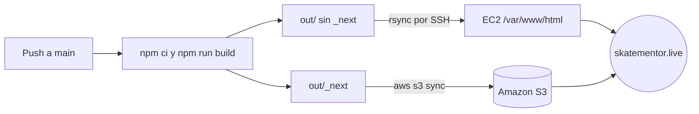
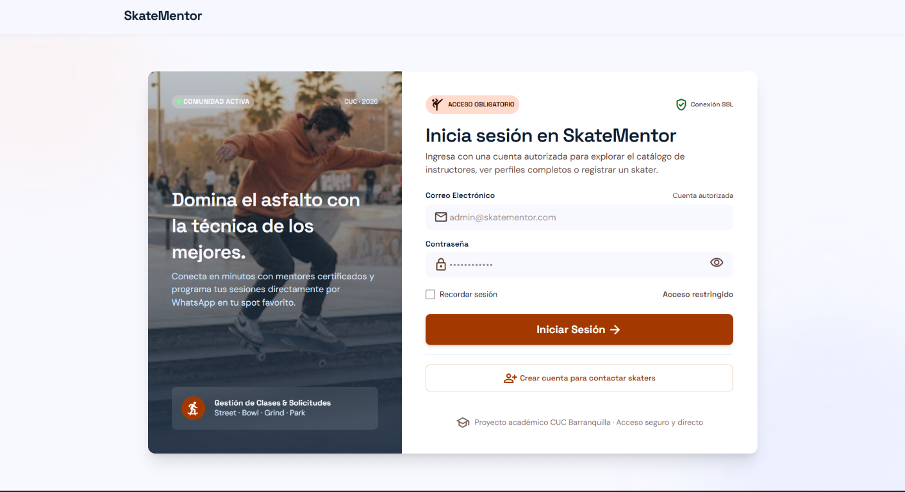

# SkateMentor 🛹

Plataforma web para encontrar skaters que ofrecen clases y contactarlos directamente.

<p>
  
  
  
  
</p>

🌐 **[skatementor.live](http://skatementor.live/)**

## Contenido

- [Sobre el proyecto](#sobre-el-proyecto)
- [Funcionalidades](#funcionalidades)
- [Tecnologías](#tecnologías)
- [Getting Started](#getting-started)
- [Compilar y desplegar](#compilar-y-desplegar)
- [Dominio personalizado y AWS](#dominio-personalizado-y-aws)
- [Arquitectura actual](#arquitectura-actual)
- [Estructura de carpetas](#estructura-de-carpetas)
- [Evidencias de funcionamiento](#evidencias-de-funcionamiento)
- [Recursos adicionales](#recursos-adicionales)
- [Equipo](#equipo)

## Sobre el proyecto

SkateMentor permite explorar perfiles de instructores de skate, consultar sus disciplinas, experiencia y tarifa por sesión, y contactarlos por WhatsApp. No incluye pagos ni reservas dentro de la aplicación.

Es un proyecto académico de Buenas Prácticas de Desarrollo de Software de la Universidad de la Costa (CUC), realizado por Vidal Niebles Cáceres y Mateo Pérez Núñez.

## Funcionalidades

- Catálogo de skaters con búsqueda por nombre, ciudad, nivel y modalidad.
- Perfiles completos con experiencia, preferencias de clase, galería, reseñas y contacto.
- Registro de nuevos perfiles para cuentas administrativas.
- Cuentas públicas para contactar y publicar reseñas como alumno.
- Verificación y reseñas administrativas.
- Avatar predeterminado para perfiles y reseñas.
- Clip opcional de presentación en formato MP4 o WebM.
- Almacenamiento local de perfiles, reseñas y clips en el navegador.
- Landing pública; se requiere iniciar sesión para explorar el catálogo y los perfiles completos.

## Tecnologías

- Next.js 16 y React 19.
- TypeScript.
- Tailwind CSS 4.
- Node.js y npm.
- Exportación estática con `output: "export"`.
- GitHub Actions para construir y desplegar.
- AWS EC2 para servir la aplicación y S3 para los recursos estáticos.
- Amazon Route 53 para el DNS del dominio personalizado.

> Actualmente no existe una base de datos activa ni carga dinámica de fotos o videos a S3. Los perfiles, cuentas y reseñas creados desde la interfaz se guardan en `localStorage`; los clips se guardan en IndexedDB. Esos datos no se comparten automáticamente entre dispositivos o navegadores.

> **Límite de acceso:** el requisito de inicio de sesión se aplica en la interfaz del sitio estático. No es una protección de seguridad de servidor; para proteger datos realmente se necesita autenticación y autorización en un backend.

## Getting Started

Requisitos: Node.js 20 o superior y npm.

```bash
git clone https://github.com/mateofernando862-hash/skatementor.git
cd skatementor
npm install
npm run dev
```

Abre [http://localhost:3000](http://localhost:3000/).

## Compilar y desplegar

### Compilar

```bash
npm run build
```

Como [next.config.ts](next.config.ts) usa `output: "export"`, el build genera la carpeta `out/` con el HTML estático, las imágenes de `public/` y la carpeta `out/_next/` con el CSS y el JavaScript.

### Desplegar

El despliegue es automático con cada `push` a `main` o mediante **Actions → Deploy Next.js (estático) a EC2 + S3 → Run workflow**.



Pasos del flujo definido en [.github/workflows/deploy.yml](.github/workflows/deploy.yml):

1. **Checkout** del repositorio.
2. Configuración de **Node.js 20** con caché de npm.
3. `npm ci` para instalar las dependencias.
4. `npm run build` con `ASSET_PREFIX` apuntando al bucket de S3.
5. Validación de la exportación estática.
6. Configuración temporal de credenciales AWS.
7. Sincronización de `out/_next` con el bucket de S3.
8. Configuración de SSH y copia del resto de `out/` a `/var/www/html/` en EC2.

Secretos necesarios en **GitHub → Settings → Secrets and variables → Actions**:

| Secreto | Uso |
| --- | --- |
| `AWS_ACCESS_KEY_ID` | Credencial temporal de AWS |
| `AWS_SECRET_ACCESS_KEY` | Credencial temporal de AWS |
| `AWS_SESSION_TOKEN` | Token temporal de la sesión de AWS Academy |
| `EC2_HOST` | Dirección o IP de la instancia EC2 |
| `EC2_USER` | Usuario SSH de la instancia |
| `EC2_SSH_KEY` | Llave privada `.pem` completa |

> Las credenciales temporales de AWS Academy expiran al terminar la sesión. Deben actualizarse antes de ejecutar un despliegue que las necesite.

Para comprobar el despliegue, abre [http://skatementor.live](http://skatementor.live/) y [http://skatementor.live/health.html](http://skatementor.live/health.html). La segunda URL verifica que el servidor web responda con `OK`.

## Dominio personalizado y AWS

La aplicación está disponible mediante el dominio personalizado **[skatementor.live](http://skatementor.live/)**.

El dominio fue adquirido en **name.com** mediante el beneficio de GitHub Student Developer Pack y configurado con los nameservers de Amazon Route 53. Route 53 resuelve el dominio hacia la dirección IPv4 pública asociada a la instancia EC2. El grupo de seguridad de la instancia controla el acceso al puerto web y al acceso SSH.

La instancia EC2 sirve el HTML exportado y recibe el contenido generado por GitHub Actions. Los recursos estáticos de Next.js se sincronizan con el bucket de Amazon S3.


## Arquitectura actual

El proyecto se construye como una aplicación estática. GitHub Actions genera la carpeta `out/`, sincroniza los recursos `out/_next` con S3 y copia el HTML al servidor EC2.

```text
Usuario
   │
   ▼
Route 53 / skatementor.live
   │
   ▼
EC2 / servidor web
   ├── HTML y recursos locales
   └── HTML enlaza recursos /_next desde S3

Navegador
   ├── localStorage: perfiles, cuentas y reseñas
   └── IndexedDB: clips locales
```

Como trabajo futuro pueden incorporarse MySQL, autenticación segura, almacenamiento compartido de fotos y clips en S3 e HTTPS. También sería necesario reemplazar la exportación estática por un backend persistente cuando se quiera compartir datos entre usuarios y dispositivos.

## Estructura de carpetas

```text
skatementor/
├── .github/workflows/       # Construcción y despliegue automático
├── app/                     # Páginas, componentes y datos
├── lib/                     # Autenticación y almacenamiento local de clips
├── public/                  # Recursos públicos
├── docs/evidencias/         # Capturas de funcionamiento
├── next.config.ts           # Exportación estática y assetPrefix
├── package.json             # Scripts y dependencias
└── README.md
```

## Evidencias de funcionamiento

### Inicio de sesión



### Catálogo de skaters


### Registro de nuevo skater


### Catálogo con perfiles disponibles


### Perfil completo


## Recursos adicionales

| Tema | Enlace |
| --- | --- |
| Next.js: exportación estática | [Documentación](https://nextjs.org/docs/app/guides/static-exports) |
| Next.js: `assetPrefix` | [Documentación](https://nextjs.org/docs/app/api-reference/config/next-config-js/assetPrefix) |
| Tailwind CSS | [Documentación](https://tailwindcss.com/docs) |
| GitHub Actions | [Documentación](https://docs.github.com/actions) |
| Amazon EC2 | [Documentación](https://docs.aws.amazon.com/ec2/) |
| Amazon S3 | [Documentación](https://docs.aws.amazon.com/s3/) |
| Amazon Route 53 | [Documentación](https://docs.aws.amazon.com/route53/) |
| GitHub Student Developer Pack | [GitHub Education](https://education.github.com/pack) |
| name.com | [Sitio oficial](https://www.name.com/) |

## Equipo

| Integrante | Programa |
| --- | --- |
| Vidal Niebles Cáceres | Ingeniería de Sistemas |
| Mateo Pérez Núñez | Ingeniería de Sistemas |

**Docente:** Kelly Villa Collazos  
**Institución:** Universidad de la Costa (CUC)  
**Año:** 2026
